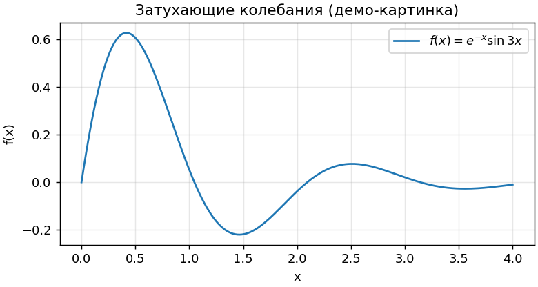

# Демонстрация возможностей

Этот файл показывает, как бот конвертирует **Markdown** в DOCX и PDF:
заголовки, списки, таблицы, код и, конечно, формулы LaTeX.

## Формулы

Строчные формулы пишутся в долларах: $E = mc^2$, а также
$\alpha + \beta = \gamma$ и даже $\int_0^1 x^2\,dx = \tfrac{1}{3}$.
Обозначения через скобки тоже работают: \(a^2 + b^2 = c^2\).

Выносные формулы можно записать двойными долларами:

$$\int_{-\infty}^{\infty} e^{-x^2}\,dx = \sqrt{\pi}$$

Или классическим окружением equation:

\begin{equation}
  \nabla \cdot \mathbf{E} = \frac{\rho}{\varepsilon_0}
\end{equation}

Система уравнений через align (в DOCX станет многострочным уравнением Word):

\begin{align}
  \frac{d}{dx}e^x &= e^x \\
  \frac{d}{dx}\ln x &= \frac{1}{x}
\end{align}

А вот запись в коде формулой не считается — конвертер её не трогает:

```text
$E = mc^2$ внутри блока кода — это просто текст
```

## Таблицы

| Величина | Символ | Значение |
|----------|--------|----------|
| Скорость света | $c$ | $299\,792\,458$ м/с |
| Постоянная Планка | $h$ | $6{,}626 \cdot 10^{-34}$ Дж·с |
| Гравитационная постоянная | $G$ | $6{,}674 \cdot 10^{-11}$ |

## Код и прочее

```python
def norm(v):
    return sum(x**2 for x in v) ** 0.5
```

> Примечание: формулы в DOCX вставляются как уравнения Word (OMML) —
> их можно редактировать прямо в документе.

Список: заголовки, **жирный**, *курсив*, `inline code`,
[ссылки](https://pandoc.org) и картинки:



1. Первый пункт
2. Второй пункт
3. Третий пункт
